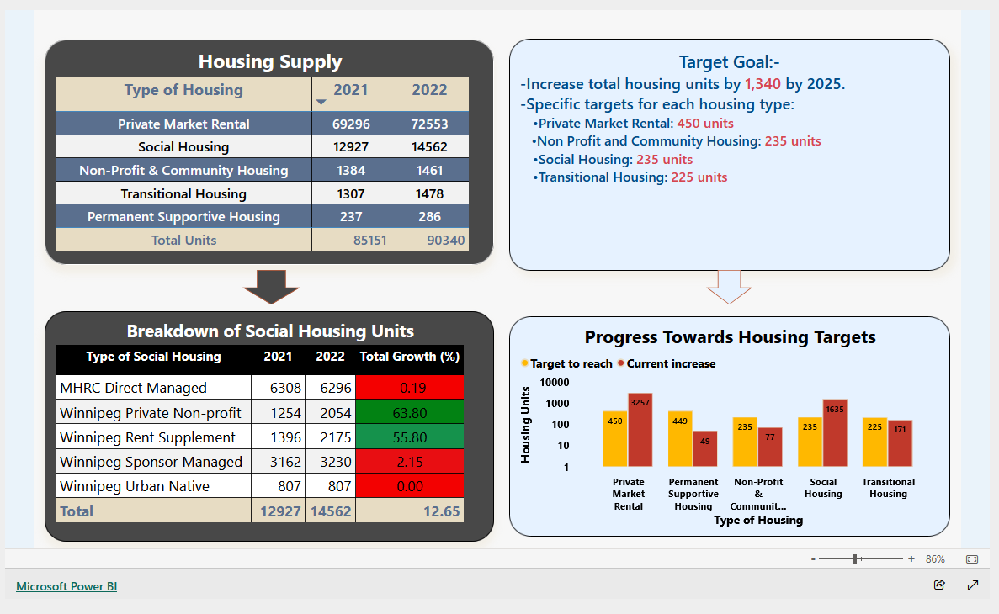

# Dashboards

## Housing supply and targets (Power BI)

A one-page report comparing housing supply by type across two years and tracking progress toward unit targets:

- **Housing supply table:** units by housing type for 2021 and 2022, with totals.
- **Social housing breakdown:** units by program type, with year-over-year growth highlighted by conditional formatting.
- **Progress toward targets:** target versus actual increase for each housing type, on a log-scale column chart so small and large categories read on one axis.
